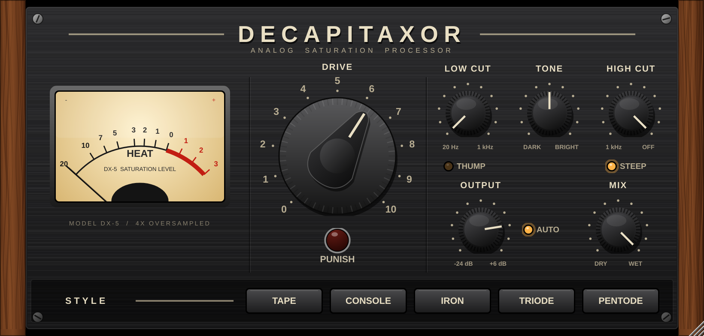

# Decapitaxor

Saturador analógico VST3 para **Windows / FL Studio** (64-bit).



## Descargar

Cada push a `main` compila el plugin en GitHub Actions:

- **Releases → `latest`** → `Decapitaxor-Windows-VST3.zip`
- o **Actions → último build → Artifacts**

## Instalar en FL Studio

1. Descomprime el zip y copia la carpeta `Decapitaxor.vst3` a
   `C:\Program Files\Common Files\VST3\`
2. En FL Studio: **Options → Manage plugins → Find installed plugins**.
3. Búscalo como **Decapitaxor** (efecto, categoría Distortion) y cárgalo en un slot del Mixer.

## Controles

| Control | Función |
|---|---|
| **DRIVE** (0–10) | Cuánto se empuja la señal hacia el circuito (0 a +36 dB). |
| **PUNISH** | +20 dB extra de drive para distorsión extrema. |
| **STYLE** | 5 modelos de saturación: **Tape** (suave, compresión de cinta, head bump), **Console** (brillante, al frente), **Iron** (transformador, graves gordos, 2º armónico), **Triode** (válvula asimétrica cálida), **Pentode** (agresivo, armónicos impares). |
| **LOW CUT** + **THUMP** | Filtro pasa-altos *antes* de la saturación (20 Hz–1 kHz). Thump deja un bump resonante en el corte. |
| **TONE** | Inclinación Dark ↔ Bright después de la saturación. |
| **HIGH CUT** + **STEEP** | Pasa-bajos (1 kHz–Off). Steep = 24 dB/oct en vez de 12. |
| **OUTPUT** + **AUTO** | Nivel de salida (−24 a +6 dB). Auto compensa el volumen al subir el Drive para que solo oigas el cambio de color. |
| **MIX** | Dry/Wet (procesamiento paralelo, en fase). |
| **HEAT** (VU) | Nivel de salida. |

Doble clic en una perilla la regresa a su valor por defecto. La ventana se puede redimensionar arrastrando la esquina.

## Detalles técnicos

- JUCE 8, C++20, CRT estático (no requiere instalar Visual C++ Redistributable).
- Saturación con **oversampling 4x** (FIR de fase lineal) para evitar aliasing.
- Latencia reportada al host (61 muestras a 4x) y ruta dry retrasada para que el Mix no produzca filtrado de peine.
- Mono y estéreo.

## Compilar localmente (opcional)

```
cmake -S . -B build -A x64
cmake --build build --config Release
```

Decapitaxor es un proyecto independiente; no está afiliado con ningún fabricante de plugins.
